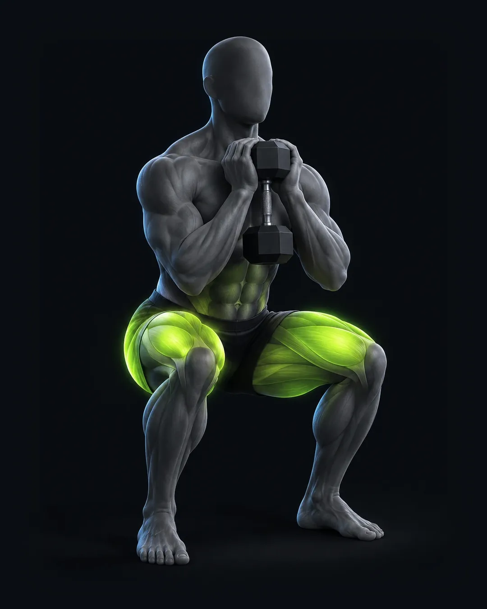

# Imágenes y videos de ejercicios: estilo nuevo

Cada ejercicio se ve en tres lugares de la app:

| Lugar | Qué se muestra |
|---|---|
| Lista de **Rutina** | Miniatura de 48 px, siempre con la imagen fija. |
| **Sesión en curso** | La foto grande. Si el ejercicio tiene video, se reproduce en bucle encima de la imagen fija. |
| Ficha **"Cómo se hace"** | Igual que en la sesión: el video si hay, y si no, la imagen fija. |

Todas siguen **un solo estilo**, hecho con la paleta de la app. El modelo es la sentadilla goblet (`img/ejercicios/sentadilla-goblet.webp`).



## El estilo

| Elemento | Cómo debe verse |
|---|---|
| Fondo | Liso **#0A0E13** (el de la app), sin piso, horizonte ni degradado. Así la imagen se funde con la tarjeta. |
| Figura | Cuerpo atlético **grafito mate** (#2B333C), liso como arcilla, sin rostro ni cabello, short negro sin logos. |
| Músculo que trabaja | El principal brilla en **lima #C8F23A**; los secundarios en lima tenue (35 %). Lo demás queda grafito. |
| Luz | Una luz suave desde arriba a la izquierda y un borde frío por detrás. Sin luces de colores. |
| Encuadre | Vertical **4:5**, cuerpo completo, vista 3/4 de frente a la altura de los ojos. La figura ocupa cerca del 80 % del alto. |
| Equipo | Real, negro mate, con un borde de luz fría. |
| Prohibido | Texto, letras, números, logos, marcas de agua, flechas, esquemas anatómicos o elementos de interfaz. |

Ya no se usan la barra anatómica ni el piso naranja y morado. La app muestra los músculos en chips, con el principal en lima.

## 1. Imagen fija (ChatGPT)

```
Create a single vertical 4:5 image (1080×1350) for a fitness app exercise library.

Subject: an athletic adult performing a goblet squat, at the bottom of the movement: thighs parallel to the floor, chest up, holding one dumbbell vertically against the chest with both hands, feet shoulder-width, heels down, knees tracking over the toes.

Style: premium 3D render. The figure is a smooth matte graphite-gray sculpted body (like dark clay, #2B333C), no face details, no hair, no clothing logos, plain black shorts. Anatomically accurate proportions, realistic weight and balance.

Muscle highlight: the main working muscles (quadriceps and glutes) glow from within in electric lime #C8F23A, softly emissive with a gentle bloom; secondary muscles (adductors and core) in a faint, 35% lime. Everything else stays graphite.

Equipment: one hexagonal dumbbell, matte black with a thin cool rim light.

Background: perfectly flat, solid #0A0E13 (very dark blue-black) filling the whole frame, seamless, no floor line, no horizon, no gradient, no studio props. Only a very soft contact shadow under the feet.

Lighting: one soft key light from upper left, a subtle cool rim light from behind to separate the figure from the background. Low contrast, calm, high-end.

Camera: eye level, three-quarter front view, full body visible from head to feet, centered, figure fills about 80% of the frame height with even margins.

Do not include: any text, letters, numbers, labels, logos, watermarks, arrows, diagrams, anatomy charts, UI elements, colored studio lights, reflections on the floor, or extra people.
```

Si sale con texto o con otro fondo, pídele: *"Same image, but remove all text and make the background exactly flat #0A0E13."*

## 2. Video en bucle (Gemini / Veo)

Adjunta la imagen fija aprobada como primer cuadro:

```
Use the attached image as the first frame and the exact visual style reference.

Create a 5-second seamless looping video, vertical 9:16, of the same graphite figure performing one slow, controlled goblet squat:
- 0.0–0.5 s: standing tall, holding the dumbbell at the chest.
- 0.5–2.5 s: lowers smoothly to the bottom position (thighs parallel), chest up, heels down.
- 2.5–3.0 s: brief pause at the bottom.
- 3.0–4.5 s: drives back up to standing.
- 4.5–5.0 s: settles into exactly the same standing pose as the first frame, so the video loops without a jump.

The lime #C8F23A glow on the quadriceps and glutes gets brighter while lowering and during the pause, and dims slightly when standing.

Camera completely locked: no zoom, no pan, no shake. Same three-quarter front view, the whole body always in frame, centered, with space above the head and below the feet.

Keep the background perfectly flat #0A0E13 the entire time, same lighting, no flicker, no morphing of the body or the dumbbell, realistic tempo and balance.

No text, no logos, no music, no extra people, no camera cuts.
```

## 3. Siguientes ejercicios (mismo estilo)

Adjunta siempre la imagen de la sentadilla goblet como referencia:

```
Use the attached image as a strict style reference: same graphite matte figure, same flat #0A0E13 background, same lighting, same camera distance and three-quarter view, same lime #C8F23A glow treatment. Keep everything identical except the exercise.

New exercise: [EJERCICIO EN INGLÉS, p. ej. seated cable row], shown at [POSICIÓN CLAVE, p. ej. the end of the pull, elbows behind the torso].
Main working muscles glowing lime: [MÚSCULO PRINCIPAL, p. ej. mid back and lats]. Secondary at 35%: [SECUNDARIOS, p. ej. biceps and rear delts].
Equipment: [EQUIPO, p. ej. low cable machine with a V-handle], matte black with a thin cool rim light.

Vertical 4:5, 1080×1350, full body, centered. No text, letters, logos, watermarks, arrows, diagrams or UI.
```

Para probar cada resultado dentro de las pantallas de la app antes de elegirlo, usa el **probador de imágenes**: https://claude.ai/artifact/BJekk73jMKUVPbDJx5yiRD

## Cómo subirlas

1. **Imagen fija.** Nombra el archivo con el nombre del ejercicio tal como aparece en el plan (por ejemplo `Remo en polea baja.png`) y ejecuta:
   ```
   pip install pillow
   python3 herramientas/preparar-imagenes.py CARPETA_CON_TUS_IMÁGENES
   ```
   El script deja en `img/ejercicios/` la imagen en el marco de la app (1080 × 1350, de 30 a 60 KB) y su miniatura `mini-…`.
2. **Video.** De lo que entrega Gemini (16:9, unos 10 s, con audio) se sacan tres cosas:
   - Una sola repetición que cierre en bucle limpio.
   - Un recorte a 4:5 centrado en la figura, con el fondo extendido arriba y abajo.
   - Dos archivos sin audio en `img/ejercicios/`: `<nombre>.webm` (unos 100 KB) y `<nombre>.mp4` (unos 140 KB).

   Después se agrega el nombre a `EJ_VIDEOS`, en `js/38-entreno.js`. Mándamelo y yo lo preparo; así se hizo la goblet.
3. **Sin imagen.** Si un ejercicio no tiene imagen, la app usa la de su grupo muscular y, si tampoco hay, un ícono. Si tiene imagen pero no video, se queda con la imagen fija. Nada se rompe mientras se completan.

El video no se muestra cuando el celular tiene activado "reducir movimiento", y sin conexión se ve la imagen fija.

Para la ficha "Cómo se hace", los **pasos** y el **error común** de cada ejercicio están en `EJ_PASOS`, en `js/38-entreno.js`.

## Estado actual

Hay **226 ejercicios** en el catálogo:

| Estado | Ejercicios | Qué significa |
|---|---|---|
| **Listo** | 182 | En el estilo nuevo: 3 ejercicios con imagen y video (sentadilla goblet, peso muerto rumano con mancuernas y sentadilla libre) y 179 con imagen. |
| **Rehacer** | 0 | Ya no queda ninguna imagen del estilo anterior. |
| **Falta** | 44 | No tienen imagen. |

Siguiente paso: los ejercicios marcados como **Falta**, empezando por los compuestos de cada zona.

### Rack / barra libre

| Ejercicio | Archivo | Músculos | Estado |
|---|---|---|---|
| Sentadilla libre | `sentadilla-libre` | Cuádriceps · Glúteo | **Listo** (imagen y video) |
| Sentadilla frontal | `sentadilla-frontal` | Cuádriceps · Core | **Listo** (imagen) |
| Peso muerto convencional | `peso-muerto-convencional` | Glúteo · Femorales · Espalda | **Listo** (imagen) |
| Peso muerto rumano | `peso-muerto-rumano` | Femorales · Glúteo | **Listo** (imagen) |
| Remo con barra | `remo-con-barra` | Dorsal · Romboides | **Listo** (imagen) |
| Press militar con barra | `press-militar-con-barra` | Deltoides anterior | **Listo** (imagen) |
| Press landmine | `press-landmine` | Deltoides anterior · Pecho superior | **Listo** (imagen) |
| Sentadilla a la caja | `sentadilla-a-la-caja` | Cuádriceps · Glúteo | **Listo** (imagen) |
| Peso muerto sumo | `peso-muerto-sumo` | Glúteo · Femorales · Aductores | **Listo** (imagen) |
| Buenos días con barra | `buenos-dias-con-barra` | Femorales · Espalda baja | **Listo** (imagen) |

### Mancuernas

| Ejercicio | Archivo | Músculos | Estado |
|---|---|---|---|
| Sentadilla goblet | `sentadilla-goblet` | Cuádriceps · Glúteo | **Listo** (imagen + video) |
| Desplante | `desplante` | Cuádriceps · Glúteo | **Listo** (imagen) |
| Sentadilla búlgara | `sentadilla-bulgara` | Cuádriceps · Glúteo | **Listo** (imagen) |
| Peso muerto rumano con mancuernas | `peso-muerto-rumano-con-mancuernas` | Femorales · Glúteo | **Listo** (imagen y video) |
| Press inclinado con mancuernas | `press-inclinado-con-mancuernas` | Pecho superior | **Listo** (imagen) |
| Press plano con mancuernas | `press-plano-con-mancuernas` | Pecho mayor | **Listo** (imagen) |
| Aperturas con mancuernas | `aperturas-con-mancuernas` | Pecho | **Listo** (imagen) |
| Pullover con mancuerna | `pullover-con-mancuerna` | Dorsal · Pecho | **Listo** (imagen) |
| Remo con mancuerna | `remo-con-mancuerna` | Dorsal · Romboides | **Listo** (imagen) |
| Press de hombro con mancuernas | `press-de-hombro-con-mancuernas` | Deltoides | **Listo** (imagen) |
| Elevaciones laterales | `elevaciones-laterales` | Deltoides lateral | **Listo** (imagen) |
| Elevación frontal ligera | `elevacion-frontal-ligera` | Deltoides anterior | **Listo** (imagen) |
| Pájaros con mancuerna | `pajaros-con-mancuerna` | Deltoides posterior | **Listo** (imagen) |
| Encogimientos con mancuerna | `encogimientos-con-mancuerna` | Trapecio | **Listo** (imagen) |
| Curl con barra Z | `curl-con-barra-z` | Bíceps | **Listo** (imagen) |
| Curl alterno con mancuernas | `curl-alterno-con-mancuernas` | Bíceps | **Listo** (imagen) |
| Curl martillo | `curl-martillo` | Braquial · Braquiorradial | **Listo** (imagen) |
| Extensión de tríceps sobre la cabeza | `extension-de-triceps-sobre-la-cabeza` | Tríceps (porción larga) | **Listo** (imagen) |
| Farmer walk | `farmer-walk` | Core · Agarre · Trapecio | **Listo** (imagen) |
| Caminata con peso unilateral | `caminata-con-peso-unilateral` | Oblicuos · Core | **Listo** (imagen) |
| Zancada reversa con mancuernas | `zancada-reversa-con-mancuernas` | Cuádriceps · Glúteo | **Listo** (imagen) |
| Sentadilla isométrica con mancuerna | `sentadilla-isometrica-con-mancuerna` | Cuádriceps · Glúteo | **Listo** (imagen) |
| Sentadilla sumo con mancuerna | `sentadilla-sumo-con-mancuerna` | Glúteo · Aductores | **Listo** (imagen) |
| Desplante lateral | `desplante-lateral` | Glúteo · Cuádriceps · Aductores | **Listo** (imagen) |
| Peso muerto a una pierna con mancuerna | `peso-muerto-a-una-pierna-con-mancuerna` | Femorales · Glúteo | **Listo** (imagen) |
| Peso muerto piernas rígidas con mancuernas | `peso-muerto-piernas-rigidas-con-mancuernas` | Femorales | **Listo** (imagen) |
| Pantorrilla a una pierna con mancuerna | `pantorrilla-a-una-pierna-con-mancuerna` | Gemelos | **Listo** (imagen) |
| Press declinado con mancuernas | `press-declinado-con-mancuernas` | Pecho (porción baja) | **Listo** (imagen) |
| Press en el suelo con mancuernas | `press-en-el-suelo-con-mancuernas` | Pecho mayor · Tríceps | Falta |
| Aperturas inclinadas con mancuernas | `aperturas-inclinadas-con-mancuernas` | Pecho superior | **Listo** (imagen) |
| Remo al mentón agarre ancho | `remo-al-menton-agarre-ancho` | Deltoide lateral · Trapecio | **Listo** (imagen) |
| Aguante lateral isométrico con mancuernas | `aguante-lateral-isometrico-con-mancuernas` | Deltoide lateral | Falta |
| Rotación externa acostado con mancuerna | `rotacion-externa-acostado-con-mancuerna` | Manguito rotador | **Listo** (imagen) |
| Encogimientos con mancuernas | `encogimientos-con-mancuernas` | Trapecio superior | **Listo** (imagen) |
| Curl inclinado con mancuernas | `curl-inclinado-con-mancuernas` | Bíceps (cabeza larga) | **Listo** (imagen) |
| Curl concentrado | `curl-concentrado` | Bíceps | **Listo** (imagen) |
| Curl isométrico a 90° | `curl-isometrico-a-90` | Bíceps · Braquial | Falta |
| Patada de tríceps con mancuerna | `patada-de-triceps-con-mancuerna` | Tríceps | **Listo** (imagen) |
| Press francés con mancuernas | `press-frances-con-mancuernas` | Tríceps | **Listo** (imagen) |

### Máquinas

| Ejercicio | Archivo | Músculos | Estado |
|---|---|---|---|
| Sentadilla hack | `sentadilla-hack` | Cuádriceps | **Listo** (imagen) |
| Prensa de piernas | `prensa-de-piernas` | Cuádriceps · Glúteo | **Listo** (imagen) |
| Prensa con pies bajos | `prensa-con-pies-bajos` | Cuádriceps | **Listo** (imagen) |
| Extensión de cuádriceps | `extension-de-cuadriceps` | Cuádriceps | **Listo** (imagen) |
| Abducción de cadera en máquina | `abduccion-de-cadera-en-maquina` | Glúteo medio | **Listo** (imagen) |
| Curl femoral acostado | `curl-femoral-acostado` | Femorales | **Listo** (imagen) |
| Curl femoral sentado | `curl-femoral-sentado` | Femorales | **Listo** (imagen) |
| Elevación de talones de pie | `elevacion-de-talones-de-pie` | Gemelos | **Listo** (imagen) |
| Pantorrilla en prensa | `pantorrilla-en-prensa` | Gemelos | **Listo** (imagen) |
| Press de pecho en máquina | `press-de-pecho-en-maquina` | Pecho mayor | **Listo** (imagen) |
| Press inclinado en máquina | `press-inclinado-en-maquina` | Pecho superior | **Listo** (imagen) |
| Pec deck (aperturas en máquina) | `pec-deck-aperturas-en-maquina` | Pecho | **Listo** (imagen) |
| Dominada asistida en máquina | `dominada-asistida-en-maquina` | Dorsal ancho | **Listo** (imagen) |
| Remo en máquina con apoyo de pecho | `remo-en-maquina-con-apoyo-de-pecho` | Dorsal · Romboides | **Listo** (imagen) |
| Press de hombro en máquina | `press-de-hombro-en-maquina` | Deltoides | **Listo** (imagen) |
| Elevación lateral en máquina | `elevacion-lateral-en-maquina` | Deltoides lateral | **Listo** (imagen) |
| Reverse pec deck | `reverse-pec-deck` | Deltoides posterior | **Listo** (imagen) |
| Encogimientos en máquina | `encogimientos-en-maquina` | Trapecio | **Listo** (imagen) |
| Curl predicador en máquina | `curl-predicador-en-maquina` | Bíceps (porción corta) | **Listo** (imagen) |
| Crunch en máquina | `crunch-en-maquina` | Recto abdominal | **Listo** (imagen) |
| Sentadilla en Smith | `sentadilla-en-smith` | Cuádriceps · Glúteo | **Listo** (imagen) |
| Prensa de piernas unilateral | `prensa-de-piernas-unilateral` | Cuádriceps · Glúteo | **Listo** (imagen) |
| Hip thrust en máquina | `hip-thrust-en-maquina` | Glúteo mayor | **Listo** (imagen) |
| Patada de glúteo en máquina | `patada-de-gluteo-en-maquina` | Glúteo mayor | **Listo** (imagen) |
| Peso muerto rumano en Smith | `peso-muerto-rumano-en-smith` | Femorales · Glúteo | **Listo** (imagen) |
| Pantorrilla sentado en máquina | `pantorrilla-sentado-en-maquina` | Sóleo | **Listo** (imagen) |
| Pantorrilla en Smith | `pantorrilla-en-smith` | Gemelos | **Listo** (imagen) |
| Press banca en Smith | `press-banca-en-smith` | Pecho mayor · Tríceps | **Listo** (imagen) |
| Remo en máquina con pecho apoyado | `remo-en-maquina-con-pecho-apoyado` | Espalda media | **Listo** (imagen) |
| Remo unilateral en máquina | `remo-unilateral-en-maquina` | Dorsal · Espalda media | **Listo** (imagen) |
| Remo invertido en Smith | `remo-invertido-en-smith` | Espalda media · Bíceps | **Listo** (imagen) |
| Pec deck inverso | `pec-deck-inverso` | Deltoide posterior | **Listo** (imagen) |
| Encogimientos en Smith | `encogimientos-en-smith` | Trapecio superior | **Listo** (imagen) |
| Fondos asistidos en máquina | `fondos-asistidos-en-maquina` | Tríceps · Pecho | **Listo** (imagen) |
| Extensión de tríceps en máquina | `extension-de-triceps-en-maquina` | Tríceps | **Listo** (imagen) |
| Aguante en hiperextensión | `aguante-en-hiperextension` | Espalda baja · Glúteo | **Listo** (imagen) |

### Funcional (kettlebell, cajón, trineo)

| Ejercicio | Archivo | Músculos | Estado |
|---|---|---|---|
| Step-up al cajón | `step-up-al-cajon` | Glúteo · Cuádriceps | **Listo** (imagen) |
| Fondos en paralelas | `fondos-en-paralelas` | Pecho inferior · Tríceps | **Listo** (imagen) |
| Dominadas | `dominadas` | Dorsal ancho · Bíceps | **Listo** (imagen) |
| Remo invertido en TRX | `remo-invertido-en-trx` | Espalda media · Core | **Listo** (imagen) |
| Elevación de piernas colgado | `elevacion-de-piernas-colgado` | Abdomen inferior | **Listo** (imagen) |
| Swing con kettlebell | `swing-con-kettlebell` | Glúteo · Cadena posterior | **Listo** (imagen) |
| Dominada agarre neutro | `dominada-agarre-neutro` | Dorsal · Bíceps | **Listo** (imagen) |
| Dominada excéntrica (negativa) | `dominada-excentrica-negativa` | Dorsal · Bíceps | **Listo** (imagen) |
| Aguante isométrico en barra (arriba) | `aguante-isometrico-en-barra-arriba` | Dorsal · Bíceps | **Listo** (imagen) |
| Aguante en L (L-sit) | `aguante-en-l-l-sit` | Abdomen · Tríceps | **Listo** (imagen) |
| Cuerdas de batalla | `cuerdas-de-batalla` | Sistema cardiovascular · Hombro | **Listo** (imagen) |
| Empuje de trineo | `empuje-de-trineo` | Sistema cardiovascular · Piernas | **Listo** (imagen) |

### Peso corporal

| Ejercicio | Archivo | Músculos | Estado |
|---|---|---|---|
| Sentadilla sissy asistida | `sentadilla-sissy-asistida` | Cuádriceps | **Listo** (imagen) |
| Isométrico de cuádriceps | `isometrico-de-cuadriceps` | Cuádriceps | **Listo** (imagen) |
| Sentadilla isométrica en pared | `sentadilla-isometrica-en-pared` | Cuádriceps | **Listo** (imagen) |
| Puente de glúteo | `puente-de-gluteo` | Glúteo | **Listo** (imagen) |
| Caminata lateral con banda | `caminata-lateral-con-banda` | Glúteo medio | **Listo** (imagen) |
| Curl femoral en fitball | `curl-femoral-en-fitball` | Femorales | **Listo** (imagen) |
| Curl nórdico asistido | `curl-nordico-asistido` | Femorales | **Listo** (imagen) |
| Pantorrilla unilateral en escalón | `pantorrilla-unilateral-en-escalon` | Gemelos | Falta |
| Lagartijas | `lagartijas` | Pecho · Tríceps · Core | **Listo** (imagen) |
| Rotación externa con banda | `rotacion-externa-con-banda` | Manguito rotador | **Listo** (imagen) |
| Fondos en banco | `fondos-en-banco` | Tríceps | **Listo** (imagen) |
| Plancha frontal | `plancha-frontal` | Core | **Listo** (imagen) |
| Plancha lateral | `plancha-lateral` | Oblicuos | **Listo** (imagen) |
| Dead bug | `dead-bug` | Core profundo | Falta |
| Bird-dog | `bird-dog` | Core · Erectores | **Listo** (imagen) |
| Rueda abdominal | `rueda-abdominal` | Core anterior | **Listo** (imagen) |
| Sentadilla con salto | `sentadilla-con-salto` | Cuádriceps · Glúteo | **Listo** (imagen) |
| Aguante de zancada (split squat isométrico) | `aguante-de-zancada-split-squat-isometrico` | Cuádriceps · Glúteo | **Listo** (imagen) |
| Puente de glúteo isométrico | `puente-de-gluteo-isometrico` | Glúteo | **Listo** (imagen) |
| Puente isométrico con talones elevados | `puente-isometrico-con-talones-elevados` | Femorales · Glúteo | **Listo** (imagen) |
| Aguante de pantorrilla en punta | `aguante-de-pantorrilla-en-punta` | Gemelos · Sóleo | **Listo** (imagen) |
| Lagartijas inclinadas (manos elevadas) | `lagartijas-inclinadas-manos-elevadas` | Pecho · Tríceps | **Listo** (imagen) |
| Lagartijas diamante | `lagartijas-diamante` | Tríceps · Pecho | **Listo** (imagen) |
| Lagartijas declinadas (pies elevados) | `lagartijas-declinadas-pies-elevados` | Pecho superior · Hombro | **Listo** (imagen) |
| Presión isométrica de palmas | `presion-isometrica-de-palmas` | Pecho mayor | **Listo** (imagen) |
| Aguante isométrico en lagartija (abajo) | `aguante-isometrico-en-lagartija-abajo` | Pecho · Tríceps · Core | **Listo** (imagen) |
| Superman | `superman` | Espalda baja · Glúteo | **Listo** (imagen) |
| Superman isométrico | `superman-isometrico` | Espalda baja · Glúteo | **Listo** (imagen) |
| Rotación externa isométrica en pared | `rotacion-externa-isometrica-en-pared` | Manguito rotador | **Listo** (imagen) |
| Plancha alta (brazos extendidos) | `plancha-alta-brazos-extendidos` | Core · Hombro | **Listo** (imagen) |
| Plancha lateral con pierna elevada | `plancha-lateral-con-pierna-elevada` | Oblicuos · Glúteo medio | **Listo** (imagen) |
| Hollow hold | `hollow-hold` | Abdomen · Core | **Listo** (imagen) |
| Plancha con toque de hombro | `plancha-con-toque-de-hombro` | Core · Hombro | **Listo** (imagen) |
| Crunch abdominal | `crunch-abdominal` | Recto abdominal | **Listo** (imagen) |
| Elevación de rodillas en banco | `elevacion-de-rodillas-en-banco` | Abdomen bajo | **Listo** (imagen) |
| Escaladores | `escaladores` | Core · Hombro | **Listo** (imagen) |
| Crunch bicicleta | `crunch-bicicleta` | Oblicuos · Abdomen | **Listo** (imagen) |
| Tijeras (flutter kicks) | `tijeras-flutter-kicks` | Abdomen bajo | **Listo** (imagen) |
| Salto de cuerda | `salto-de-cuerda` | Sistema cardiovascular | **Listo** (imagen) |
| Burpees | `burpees` | Sistema cardiovascular · Cuerpo completo | **Listo** (imagen) |
| Jumping jacks | `jumping-jacks` | Sistema cardiovascular | **Listo** (imagen) |

### Bancos + barra

| Ejercicio | Archivo | Músculos | Estado |
|---|---|---|---|
| Hip thrust | `hip-thrust` | Glúteo mayor | **Listo** (imagen) |
| Hiperextensión 45° | `hiperextension-45` | Erectores · Glúteo | Falta |
| Press banca plano | `press-banca-plano` | Pecho mayor · Tríceps | **Listo** (imagen) |
| Press inclinado con barra | `press-inclinado-con-barra` | Pecho superior | Falta |
| Press francés con barra Z | `press-frances-con-barra-z` | Tríceps (porción larga) | **Listo** (imagen) |
| Press banca agarre cerrado | `press-banca-agarre-cerrado` | Tríceps · Pecho | Falta |
| Hip thrust a una pierna | `hip-thrust-a-una-pierna` | Glúteo mayor | **Listo** (imagen) |
| Remo con mancuernas pecho apoyado | `remo-con-mancuernas-pecho-apoyado` | Espalda media · Dorsal | **Listo** (imagen) |
| Curl Scott con barra Z | `curl-scott-con-barra-z` | Bíceps | **Listo** (imagen) |

### Poleas / cables

| Ejercicio | Archivo | Músculos | Estado |
|---|---|---|---|
| Patada de glúteo en polea | `patada-de-gluteo-en-polea` | Glúteo mayor | **Listo** (imagen) |
| Cruce de poleas | `cruce-de-poleas` | Pecho (porción media) | **Listo** (imagen) |
| Cruce de poleas de abajo hacia arriba | `cruce-de-poleas-de-abajo-hacia-arriba` | Pecho superior | **Listo** (imagen) |
| Cruce de poleas de arriba hacia abajo | `cruce-de-poleas-de-arriba-hacia-abajo` | Pecho inferior | **Listo** (imagen) |
| Jalón al pecho | `jalon-al-pecho` | Dorsal ancho | **Listo** (imagen) |
| Jalón unilateral en polea | `jalon-unilateral-en-polea` | Dorsal ancho | **Listo** (imagen) |
| Pullover en polea alta | `pullover-en-polea-alta` | Dorsal ancho | **Listo** (imagen) |
| Remo en polea baja | `remo-en-polea-baja` | Dorsal · Romboides | **Listo** (imagen) |
| Face pull | `face-pull` | Deltoides posterior · Manguito | **Listo** (imagen) |
| Elevación lateral en polea | `elevacion-lateral-en-polea` | Deltoides lateral | **Listo** (imagen) |
| Elevación frontal en polea | `elevacion-frontal-en-polea` | Deltoides anterior | **Listo** (imagen) |
| Rotación externa en polea | `rotacion-externa-en-polea` | Manguito rotador | Falta |
| Curl en polea baja | `curl-en-polea-baja` | Bíceps | **Listo** (imagen) |
| Curl martillo en polea con cuerda | `curl-martillo-en-polea-con-cuerda` | Braquial | **Listo** (imagen) |
| Extensión de tríceps en polea | `extension-de-triceps-en-polea` | Tríceps | **Listo** (imagen) |
| Press Pallof | `press-pallof` | Core antirrotación | **Listo** (imagen) |
| Crunch en polea | `crunch-en-polea` | Recto abdominal | **Listo** (imagen) |
| Abducción de cadera en polea | `abduccion-de-cadera-en-polea` | Glúteo medio | **Listo** (imagen) |
| Pull-through en polea | `pull-through-en-polea` | Glúteo · Femorales | **Listo** (imagen) |
| Curl femoral en polea con tobillera | `curl-femoral-en-polea-con-tobillera` | Femorales | **Listo** (imagen) |
| Jalón agarre neutro | `jalon-agarre-neutro` | Dorsal · Bíceps | **Listo** (imagen) |
| Extensión de tríceps con cuerda | `extension-de-triceps-con-cuerda` | Tríceps | **Listo** (imagen) |
| Pallof isométrico (sostén al frente) | `pallof-isometrico-sosten-al-frente` | Core · Oblicuos | **Listo** (imagen) |
| Leñador en polea | `lenador-en-polea` | Oblicuos · Core | **Listo** (imagen) |

### Cardio

| Ejercicio | Archivo | Músculos | Estado |
|---|---|---|---|
| Caminata inclinada | `caminata-inclinada` | Cardiovascular | Falta |
| Elíptica | `eliptica` | Cardiovascular | **Listo** (imagen) |
| Bicicleta estática | `bicicleta-estatica` | Cardiovascular | **Listo** (imagen) |
| Remo ergómetro | `remo-ergometro` | Cardiovascular · Espalda | **Listo** (imagen) |
| Trote en caminadora | `trote-en-caminadora` | Sistema cardiovascular | **Listo** (imagen) |
| Bicicleta de aire | `bicicleta-de-aire` | Sistema cardiovascular | **Listo** (imagen) |
| Escaladora (stair climber) | `escaladora-stair-climber` | Sistema cardiovascular · Glúteo | Falta |
| Esquiadora (ski erg) | `esquiadora-ski-erg` | Sistema cardiovascular · Dorsal | **Listo** (imagen) |

### Discos / landmine

| Ejercicio | Archivo | Músculos | Estado |
|---|---|---|---|
| Sentadilla con disco al pecho | `sentadilla-con-disco-al-pecho` | Cuádriceps · Glúteo | **Listo** (imagen) |
| Sentadilla landmine | `sentadilla-landmine` | Cuádriceps · Core | **Listo** (imagen) |
| Hip thrust con disco | `hip-thrust-con-disco` | Glúteo mayor | **Listo** (imagen) |
| Curl femoral deslizando con discos | `curl-femoral-deslizando-con-discos` | Femorales · Glúteo | **Listo** (imagen) |
| Press de pecho con disco (squeeze press) | `press-de-pecho-con-disco-squeeze-press` | Pecho mayor | Falta |
| Remo T con barra (landmine) | `remo-t-con-barra-landmine` | Espalda media · Dorsal | **Listo** (imagen) |
| Press landmine a una mano | `press-landmine-a-una-mano` | Deltoide anterior · Pecho superior | **Listo** (imagen) |
| Elevación frontal con disco | `elevacion-frontal-con-disco` | Deltoide anterior | Falta |
| Aguante frontal con disco | `aguante-frontal-con-disco` | Deltoide anterior · Core | Falta |
| Encogimientos con disco | `encogimientos-con-disco` | Trapecio superior | **Listo** (imagen) |
| Curl con disco | `curl-con-disco` | Braquial · Bíceps | **Listo** (imagen) |
| Extensión de tríceps con disco sobre la cabeza | `extension-de-triceps-con-disco-sobre-la-cabeza` | Tríceps | **Listo** (imagen) |
| Plancha con disco en la espalda | `plancha-con-disco-en-la-espalda` | Core | **Listo** (imagen) |
| Giro ruso con disco | `giro-ruso-con-disco` | Oblicuos | **Listo** (imagen) |
| Caminata con disco sobre la cabeza | `caminata-con-disco-sobre-la-cabeza` | Core · Hombro | **Listo** (imagen) |

### TRX

| Ejercicio | Archivo | Músculos | Estado |
|---|---|---|---|
| Sentadilla asistida en TRX | `sentadilla-asistida-en-trx` | Cuádriceps · Glúteo | **Listo** (imagen) |
| Sentadilla a una pierna asistida en TRX | `sentadilla-a-una-pierna-asistida-en-trx` | Cuádriceps · Glúteo | Falta |
| Zancada con pie en TRX | `zancada-con-pie-en-trx` | Glúteo · Cuádriceps | **Listo** (imagen) |
| Curl femoral en TRX | `curl-femoral-en-trx` | Femorales · Glúteo | Falta |
| Lagartijas en TRX | `lagartijas-en-trx` | Pecho · Core · Hombro | Falta |
| Aperturas en TRX | `aperturas-en-trx` | Pecho mayor | Falta |
| Aperturas posteriores en TRX (T) | `aperturas-posteriores-en-trx-t` | Deltoide posterior · Espalda media | Falta |
| Curl en TRX | `curl-en-trx` | Bíceps | Falta |
| Extensión de tríceps en TRX | `extension-de-triceps-en-trx` | Tríceps | Falta |
| Plancha en TRX | `plancha-en-trx` | Core · Hombro | Falta |
| Plancha lateral en TRX | `plancha-lateral-en-trx` | Oblicuos · Core | Falta |
| Rodillas al pecho en TRX | `rodillas-al-pecho-en-trx` | Abdomen · Core | Falta |
| Fallout en TRX | `fallout-en-trx` | Abdomen · Core | Falta |

### Ligas

| Ejercicio | Archivo | Músculos | Estado |
|---|---|---|---|
| Sentadilla con banda en rodillas | `sentadilla-con-banda-en-rodillas` | Cuádriceps · Glúteo | Falta |
| Extensión de rodilla con banda | `extension-de-rodilla-con-banda` | Cuádriceps | Falta |
| Puente de glúteo con banda | `puente-de-gluteo-con-banda` | Glúteo | Falta |
| Patada de glúteo con banda | `patada-de-gluteo-con-banda` | Glúteo mayor | Falta |
| Almeja con banda | `almeja-con-banda` | Glúteo medio | Falta |
| Curl femoral con banda | `curl-femoral-con-banda` | Femorales | Falta |
| Flexión plantar con banda | `flexion-plantar-con-banda` | Gemelos · Sóleo | Falta |
| Lagartijas con banda | `lagartijas-con-banda` | Pecho · Tríceps | Falta |
| Press de pecho con banda | `press-de-pecho-con-banda` | Pecho mayor | Falta |
| Aperturas con banda | `aperturas-con-banda` | Pecho mayor | Falta |
| Jalón con banda | `jalon-con-banda` | Dorsal | Falta |
| Remo sentado con banda | `remo-sentado-con-banda` | Espalda media | Falta |
| Face pull con banda | `face-pull-con-banda` | Deltoide posterior · Manguito | Falta |
| Elevación lateral con banda | `elevacion-lateral-con-banda` | Deltoide lateral | Falta |
| Rotación interna con banda | `rotacion-interna-con-banda` | Manguito rotador | Falta |
| Curl con banda | `curl-con-banda` | Bíceps | Falta |
| Extensión de tríceps con banda | `extension-de-triceps-con-banda` | Tríceps | Falta |
| Press Pallof con banda | `press-pallof-con-banda` | Core · Oblicuos | Falta |
| Leñador con banda | `lenador-con-banda` | Oblicuos · Core | Falta |
